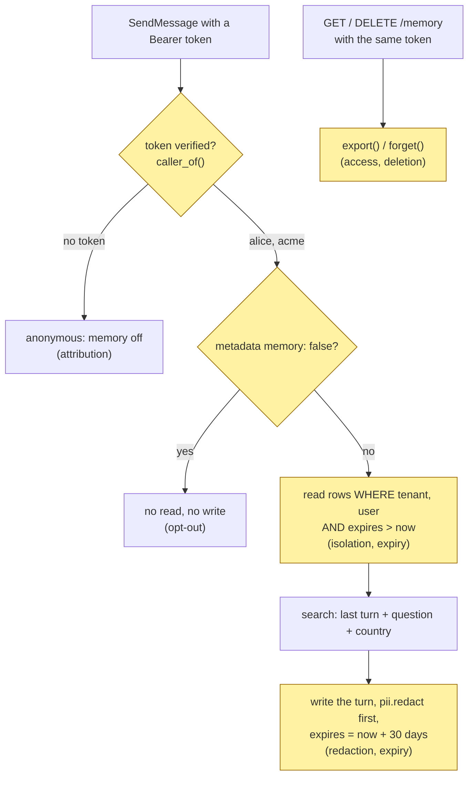
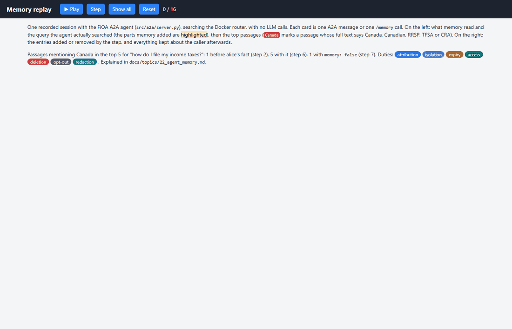

# 22 · Agents that remember

A conversation has a **past**: "how are they taxed?" means nothing without the previous message, and a user who said
"I live in the UK" yesterday expects the agent to know it today. This topic explains agent memory with a toy you can
run, the six duties an agent takes on when it remembers a logged-in user (and where each one is enforced), how the
A2A server ([21_a2a.md](21_a2a.md)) uses memory, a recorded replay of a session, and what memory measured on
follow-up questions and on a remembered country.

Code: `src/agent/memory.py`, the memory part of `src/a2a/server.py`, `scripts/memory_eval.py` and
`scripts/memory_replay.py`. Part C of [demo_security_a2a_memory.md](../guides/demo_security_a2a_memory.md) walks
through the six duties by hand, printing every request and response.

## 1. Two kinds of memory

| kind | lifetime | example | how it is used |
|---|---|---|---|
| short-term (conversation) | one `contextId` | "I hold some US stocks that pay dividends." then "how are they taxed?" | a follow-up is searched together with the last turn |
| long-term (user) | across conversations, until it expires or is deleted | "I live in the UK" | the country is added to searches that don't name one |

Both serve one purpose here: making the **search query** carry what the conversation already established.
Agent frameworks keep more (summaries of old conversations, preferences, tool results), but every kind raises the
same questions as below.

### Toy: memory step by step

```python
from src.agent.memory import MemoryStore, contextualize, extract_facts, needs_context

print(extract_facts("I'm based in the UK and I want to buy a house"))
print(needs_context("how are they taxed?"), needs_context("how are dividends taxed?"))

m = MemoryStore()                                  # SQLite in RAM
m.remember_fact("acme", "alice", "I live in the UK")
m.remember_turn("acme", "alice", "chat-1", "I hold some US stocks that pay dividends", [])
print(contextualize(m, "acme", "alice", "chat-1", "how are they taxed?")["query"])
print(contextualize(m, "acme", "bob", "chat-1", "how are they taxed?")["query"])        # bob: nothing of alice's
m.remember_turn("acme", "alice", "chat-1", "my email is jane.doe@example.com", [])
print([e["text"] for e in m.export("acme", "alice")])
print(m.forget("acme", "alice"), m.export("acme", "alice"))
```

```
[{'type': 'country', 'value': 'UK', 'text': 'I live in UK'}]
True False
I hold some US stocks that pay dividends how are they taxed? UK
how are they taxed?
['I live in UK', 'I hold some US stocks that pay dividends', 'my email is [EMAIL]']
3 []
```

Read the output line by line: the fact extractor found the country; "they" marks a follow-up, "dividends" doesn't;
alice's follow-up is searched with her last turn and her country; bob, in the same tenant and even with the same
conversation id, gets nothing; the email was redacted before it was stored; and `forget` removed all three entries.

## 2. Three ways to resolve a follow-up

| approach | cost | on 100 generated follow-ups (R@10; the original question scores 0.491) |
|---|---|---|
| nothing (search the follow-up as typed) | 0 | 0.103 |
| rule: prepend the last turn when the follow-up points back | 0 | 0.439 |
| always prepend the last turn | 0 | 0.444 |
| LLM rewrite into one standalone query | 1 LLM call | 0.455 |

The LLM rewrite is the standard answer in conversational search ("query rewriting"), and it is the best here, but
by 0.016 recall. Prepending is free and gets most of the way, because a search engine doesn't mind a slightly
redundant query. The rule exists for the case where prepending hurts: a new, unrelated question in the same
conversation would drag the old topic in.

## 3. Six duties of an agent that remembers a logged-in user

An agent online can keep memory about a logged-in user, but from then on it holds personal data about that person,
and it takes on six duties: **attribution** (whose memory is this), **isolation** (nobody else sees it),
**expiry** (it does not live forever), **access** (the user can see it), **deletion** (the user can remove it) and
**opt-out** (the user can say "don't remember this"). Redaction goes with them: what the agent should never hold is
removed before anything is stored.

Each duty is enforced at one point in the code. This is where those points sit in one task:



| duty | what it means here | where it is enforced | the test that proves it | replay step |
|---|---|---|---|---|
| attribution | memory belongs to a verified token's (tenant, user); with no token there is no memory, because nobody could later ask to see or delete it | `mem_on = ... and caller.user is not None` in `run_task` (`src/a2a/server.py`); `MemoryStore._add` raises without tenant and user; `/memory` answers 401 without a token | `test_memory_carries_the_conversation_and_the_users_facts` (anonymous), `test_memory_api_export_redacts_and_forget_deletes` (401), `test_memory_expires_and_a_new_country_replaces_the_old` (ValueError) | 1 |
| isolation | every read and delete filters on tenant and user; a conversation's turns are read within the caller's own rows, so knowing another user's `contextId` gives nothing | `WHERE tenant=? AND user=?` in `export` and `forget` (`src/agent/memory.py`) | bob gets nothing of alice's in both tests above; the doctest in `memory.py` shows another tenant gets nothing | 9, 10 |
| expiry | each entry has an end date (`MEMORY_TTL_DAYS`, 30) and is never returned after it; expired rows are purged on the next write | `expires = now + ttl` in `_add`; `expires > ?` in `export`; `DELETE ... WHERE expires <= ?` before each insert | `test_memory_expires_and_a_new_country_replaces_the_old` (a fake clock) | 15, 16 |
| access | the user can list everything kept about them, oldest first, with the end dates | `GET /memory` → `export` | `test_memory_api_export_redacts_and_forget_deletes` | 11 |
| deletion | one entry (`DELETE /memory/{id}`) or everything (`DELETE /memory`); the bytes are overwritten in the file | `forget`; `PRAGMA secure_delete = ON` in `MemoryStore.__init__` | `test_memory_api_export_redacts_and_forget_deletes`, `test_forget_removes_the_text_from_the_file` | 12, 13, 14 |
| opt-out | a message with `"memory": false` in its metadata is neither helped by memory nor remembered | `use_memory` in `send_message` → `mem_on` in `run_task` | `test_memory_carries_the_conversation_and_the_users_facts` (no read, and the export count is unchanged) | 7 |
| redaction | text goes through `pii.redact` before it is stored: an email is kept as `[EMAIL]` | `_add` in `src/agent/memory.py` | `test_memory_api_export_redacts_and_forget_deletes` | 8 |

### Toy: deleting a row does not delete the text

I first had `forget` run a plain SQL `DELETE` and trusted it. Checking the file afterwards showed otherwise:

```python
import sqlite3, os, tempfile
from src.agent.memory import MemoryStore

p = os.path.join(tempfile.mkdtemp(), "m.sqlite")
m = MemoryStore(p)
m.db.execute("PRAGMA secure_delete = OFF")          # what MemoryStore did before the fix (SQLite's default)
m.remember_fact("acme", "alice", "my secret note zebra-quokka-42")
print(m.forget("acme", "alice"), m.export("acme", "alice"))
m.db.close()
print("still in the file:", b"zebra-quokka-42" in open(p, "rb").read())
```

```
1 []
still in the file: True
```

The row is gone for every query, but SQLite only marks its page as free and leaves the bytes until the page is
reused. Anyone with the file (a backup, a copied disk) could still read what the user deleted. With
`PRAGMA secure_delete = ON`, which `MemoryStore` now sets, SQLite overwrites deleted content with zeros, and the same
check prints `False` (`test_forget_removes_the_text_from_the_file`).

### What the duties do not cover yet

- **Deletion is memory only.** If the router's audit toggle is on, the questions alice searched are also in the
  audit log ([17_security.md](17_security.md)), redacted. That log is append-only and hash-chained on purpose, so
  `DELETE /memory` does not touch it; a real system would document that retention separately.
- **Opt-out is per message.** There is no account setting "never remember me"; a client has to send
  `"memory": false` every time.
- **Access shows the stored text, not how it was used.** The task metadata (`memory.query_searched`, `facts_used`,
  `turn_used`) shows that per task, but nothing collects it for the user.

A wrong memory is worse than none: the agent would silently search for the wrong country. That is why a new country
fact replaces the old one instead of adding to it (people move), and why every task's metadata shows exactly which
memories changed its search.

## 4. Quick start

With the stack and the A2A server running (see [21_a2a.md](21_a2a.md#2-quick-start)):

| I want to | command |
|---|---|
| continue a conversation | add `--context <the contextId the first answer printed>` |
| tell it a fact about me | `python -m src.a2a.client --remember "I live in Canada" --token $(python -m scripts.mint_token alice)` |
| see / delete my memory | `curl -H "Authorization: Bearer $TOKEN" localhost:8300/memory`, `curl -X DELETE ...` |
| measure memory | `python scripts/memory_eval.py` (`--confirm-spend --llm-rewrite` for the LLM variant) |
| record the memory replay | `python scripts/memory_replay.py` (no LLM calls; section 6) |
| try it in a browser | the A2A chat page's memory panel ([21_a2a.md](21_a2a.md), section 7) |

| option / variable | default | what it sets |
|---|---|---|
| `--memory-db` / `MEMORY_DB` | `a2a_memory.sqlite` | the memory file; `off` disables memory, `:memory:` keeps it in RAM |
| `MEMORY_TTL_DAYS` | 30 | how long a memory entry lives |

## 5. Memory in the A2A server

`src/agent/memory.py` keeps two kinds of entries in one SQLite table, keyed by tenant and user:

| kind | what | written when | used for |
|---|---|---|---|
| `turn` | a question the user asked, with the doc ids it got, under its `contextId` | a task completes | a follow-up in the same conversation is searched together with the last turn |
| `fact` | something about the user, e.g. "I live in Canada" | the message says it ("I live in", "I'm from", "I moved to", ...), the client sends `remember`, or `POST /memory` | the country is added to every search that doesn't already name it |

**When is a question a follow-up?** `needs_context` looks for words that point back (it, that, they, their, one,
each, ...) or an opening like "what about". On the generated follow-ups below it flagged 97%. Only the last turn is
used, and only for the search: the LLM still sees the question as asked plus the search results.

**Privacy.** Attribution, isolation, expiry, access, deletion, opt-out and redaction are section 3.

**The memory API** (REST on the A2A server; A2A itself has no memory API). Each call needs the user's token and
only ever touches that user's entries:

| request | what it does |
|---|---|
| `GET /memory` | everything kept about me, oldest first |
| `POST /memory {"text": "I live in Canada"}` | remember a fact |
| `DELETE /memory/{id}` | forget one entry |
| `DELETE /memory` | forget everything |

## 6. The memory replay

`scripts/memory_replay.py` runs the real A2A server in-process with a fresh memory, against the Docker router, and
records 16 steps. Before and after each step it exports the caller's memory, so the page shows which entries the
step added or removed next to the query the agent actually searched:
[scenarios/SimpleScenarios/results/MemoryReplay/replay.html](../../scenarios/SimpleScenarios/results/MemoryReplay/replay.html).
The memory's clock is a function the script controls, so "31 days later" is one step.



| step | who | what happens | what memory did |
|---|---|---|---|
| 1 | anonymous | "I live in Canada. how do I file my income taxes?" | nothing stored |
| 2 | alice | "how do I file my income taxes?" | searched as typed; 1 of the top 5 passages is about Canada; the turn is stored |
| 3 | alice | "I live in Canada. How are capital gains taxed?" | the country fact is stored; this question already says Canada, so its search is unchanged |
| 4 | alice | "what about dividends?" | a follow-up: searched together with step 3's question |
| 5 | alice | "should I pay off my mortgage early?" | not a follow-up; " Canada" is added |
| 6 | alice | step 2's question, in a new conversation | " Canada" is added; 5 of the top 5 are about Canada |
| 7 | alice | the same, with `memory: false` | searched as typed (1 of 5 about Canada again); nothing stored |
| 8 | alice | "my email is jane.doe@example.com, how do I report a phishing scam?" | stored as "my email is [EMAIL], ..." |
| 9 | bob | "what about dividends?" with alice's `contextId` | nothing of alice's: searched as typed |
| 10 | bob | "I'm from the UK. how do I file my income taxes?" | his own UK fact, under (globex, bob) |
| 11 | alice | `GET /memory` | 7 entries: 1 fact and 6 turns |
| 12, 13 | alice | delete the email turn, then everything | 1, then the other 6 |
| 14 | alice | "what about dividends?" in the first conversation again | searched as typed: its turns and the fact are gone |
| 15, 16 | bob | 31 days pass, then he asks again | his 3 entries have expired; searched as typed |

Step 8 also shows a limit: memory stores the email redacted, but the search for that question still sends the
address to the router as typed. The router redacts the passages it returns when its `pii_redaction` toggle is on,
and always stores the question redacted in its audit log ([17_security.md](17_security.md)), but it searches the
question as it arrives.

## 7. Results

### Conversation memory: follow-up questions

`scripts/memory_eval.py` (`results/memory_eval.json`). Azure split each of the 100 plain dev questions into a first
message that sets the topic and a follow-up that only makes sense after it (`data/followups_plain.jsonl`), e.g.

> Q: Why is gold not a good investment?
> first: "I'm thinking about investing in gold."  follow-up: "Why might it not be a good investment?"

Together the two ask the original question, so its relevance labels still apply. Hybrid search, minilm-ft:

| what is searched | R@10 | nDCG@10 |
|---|---|---|
| the original question (upper bound) | 0.491 | 0.429 |
| the follow-up alone (no memory) | 0.103 | 0.089 |
| memory rule: last turn + follow-up when `needs_context` fires | 0.439 | 0.401 |
| always prepend the last turn | 0.444 | 0.407 |
| an LLM rewrites the follow-up into a standalone query (1 call) | 0.455 | 0.410 |

Without memory a follow-up loses four fifths of its recall. The free rule recovers most of it; the LLM rewrite
gains another 0.016 R@10 for one LLM call per follow-up. The rule's first version missed "one", "their" and "each"
and flagged 92% (R@10 0.421); adding them took it to 97% and 0.439.

### User memory: a country fact

Ten generic questions ("what retirement account should I open?", "how are capital gains taxed?", ...) for a user
whose memory says "I live in <country>". The measure is the share of the top 10 passages that mention the country
(its name or words such as RRSP, ISA, rupee, superannuation). It shows whether the results moved toward the
country, not whether they answer better; there are no labels for that.

| country | without the fact | with the fact |
|---|---|---|
| Canada | 8% | 54% |
| UK | 9% | 70% |
| India | 2% | 35% |
| Australia | 1% | 25% |

For "how do I file my income taxes?" with "I live in India", the top 3 change from US Form 1040 answers to "Since
you are living in India and earning income not from salary, you must file your tax return under ITR4..." and two
posts about Indian residents and US returns. It doesn't always help at the top: for "what retirement account should
I open?" with Canada, the top 4 hardly change, and the Canadian posts come in further down.

## 8. How it is checked

| what | where |
|---|---|
| memory: follow-up and fact change the search; bob and anonymous get nothing of alice's; per-message opt-out (no read, no write); export is redacted; forget one and all; expiry; a new country replaces the old; no identity, no memory | `tests/test_a2a.py`, doctests in `src/agent/memory.py` |
| a forgotten entry's text is no longer in the SQLite file | `tests/test_a2a.py` (`test_forget_removes_the_text_from_the_file`) |
| every duty on the live stack, step by step | `scripts/memory_replay.py` (`results/MemoryReplay/`) |
| follow-up recall and the country shift on the real corpus | `scripts/memory_eval.py` (`results/memory_eval.json`) |

## 9. Pitfalls and what I would do next

- A follow-up rule that fires on a new topic drags the old topic into the search. Measure both directions.
- A fact that is true but irrelevant still shifts results: adding "Canada" moved 54% of the top 10 to Canadian
  posts on average, but for "what retirement account should I open?" the top answers barely changed. A shift
  toward a country is not the same as better answers.
- Memory makes results depend on history, so the same question gives different results to different users. Log
  `query_searched` with every result, or bugs can't be reproduced.
- **The country rule is narrow.** Four countries and a regex. An LLM could extract facts of any kind (age, risk
  appetite, employer plan), with the same redaction and deletion rules; each new kind of fact needs its own check
  that it improves results.
- **Memory changes the search, not the question.** The LLM skills see the question as asked. Passing the facts
  into the prompt as well is easy, and is also where a stale or wrong memory would do the most harm.
- **Check deletion on the storage, not through the API.** `forget` returned 1 and `GET /memory` showed nothing
  while the text was still in the file (section 3). The same applies to backups, replicas and logs.
